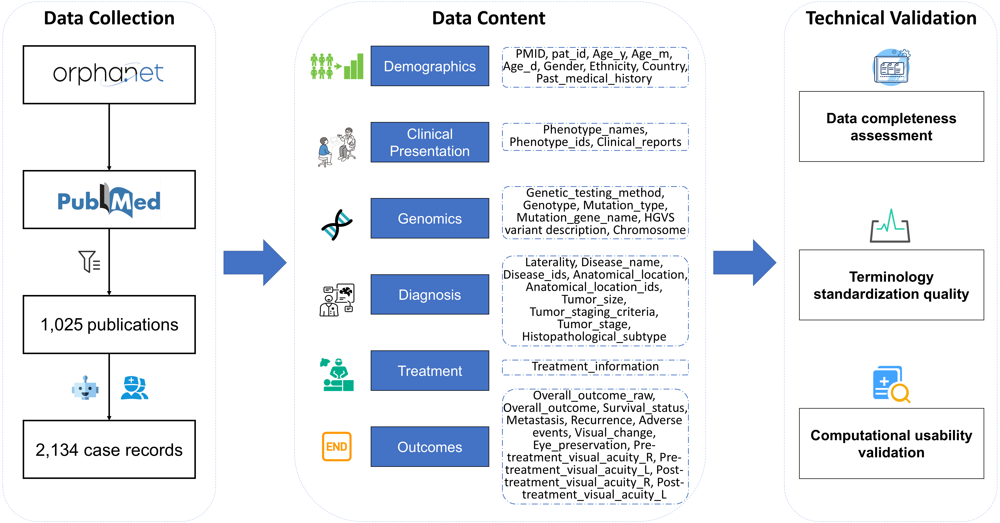

<div align="center">
  <h1>ROTD 1.0: A standardized dataset linking phenotypes, genetic findings, diagnoses, treatments and outcomes in rare ocular tumors</h1>
</div>


## Overview

The **Rare Ocular Tumor Dataset (ROTD 1.0)** is a literature-derived, case-level resource for research on rare ocular tumors. It contains 2,134 cases extracted from 1,025 PubMed-indexed publications published between January 2015 and November 2025. Each record includes up to 40 fields spanning demographics, clinical presentation, genomics, diagnosis, treatment, and outcomes.

Case information was extracted with large language model assistance and reviewed and corrected by two researchers. Disease diagnoses were standardized using Orphanet and ICD-11, phenotypes using the Human Phenotype Ontology (HPO), and anatomical locations using SNOMED CT. The dataset covers 15 rare ocular tumor entities and 335 additional disease categories, including differential diagnoses and systemic comorbidities.

This repository provides the cleaned dataset used by the analysis notebooks, preprocessing and extraction materials, and code for three computational use cases. The associated dataset release is archived on Figshare.



*Figure 1. ROTD data collection, six-domain dataset structure, and technical validation workflow.*

## Dataset at a glance

| Item | Description |
| --- | --- |
| Cases | 2,134 case-level records |
| Source publications | 1,025 PubMed-indexed publications |
| Publication period | January 2015–November 2025 |
| Fields | 40 fields across six domains |
| Disease categories | 350 total: 15 rare ocular tumor entities and 335 additional categories |
| Source traceability | PMID and case-level `pat_id` fields |


## Computational use cases

The notebooks demonstrate how ROTD can support common computational analyses. Model performance depends on the task-specific cohort and available labels; the notebooks export detailed metrics and configuration information to Excel workbooks under `results/`.

| Notebook | Task | Summary |
| --- | --- | --- |
| `01-Diagnosis.ipynb` | Multilabel diagnostic classification | Predicts disease labels from structured and text-derived features. The analysis uses labels meeting the configured minimum-support threshold and a shared patient split. |
| `02-ClinicalOutcomePrediction.ipynb` | Clinical outcome classification | Evaluates six targets: overall outcome, visual change, recurrence, metastasis, survival status, and adverse events. Each target uses cases with an available label. |
| `03-SimilarCaseRetrieval.ipynb` | Similar-case retrieval | Ranks cases using structured and text-derived features and evaluates retrieval against disease labels, excluding cases from the same PMID when evaluating queries. |


## Repository structure

```text
.
├── README.md
├── figure1.png                         # Study and dataset overview
├── data/
│   ├── ROTD_final.xlsx                 # Cleaned 2,134-case, 40-field dataset
│   ├── ROTD_preprocessed.xlsx          # Diagnosis-ready, expanded phenotype/disease features
│   └── shared_train_test_split.csv    # Shared diagnosis train/test assignments
├── 01-Diagnosis.ipynb
├── 02-ClinicalOutcomePrediction.ipynb
├── 03-SimilarCaseRetrieval.ipynb
├── ROTD_Data_extraction.ipynb
├── Extraction_Prompts.py
├── clean_reports.ipynb
└── outcome_Standardization.ipynb
```

## Reproducing the analyses

### Requirements

Use Python 3.10 or later with a Jupyter-compatible environment. Install the dependencies listed in [`requirements.txt`](requirements.txt):

```bash
python -m pip install -r requirements.txt
```

The requirements include the libraries for the analysis notebooks and the extraction and standardization workflows. PyTorch may need a platform-specific installation to match your CPU or CUDA setup; use the official PyTorch installation selector when a GPU build is required.

### Configure embeddings

The notebooks look for `LLM_config.json` in the repository root when they need to request embeddings. Create this file locally with an API key and, if needed, a compatible base URL. For example:

```json
{
  "api_key": "YOUR_API_KEY",
  "base_url": "https://api.openai.com/v1"
}
```


### Run a notebook

Run Jupyter from the repository root so the relative `data/` paths resolve correctly:

```bash
jupyter lab
```

Open the notebook for the desired use case and execute its cells from top to bottom. Generated result workbooks are written to `results/`. The diagnosis notebook uses the included shared split; the clinical outcome notebook creates outcome-specific splits if they are not already present. Confirm the input files and API configuration before starting a run.

## Citation

The ROTD is currently under review for publication. 
